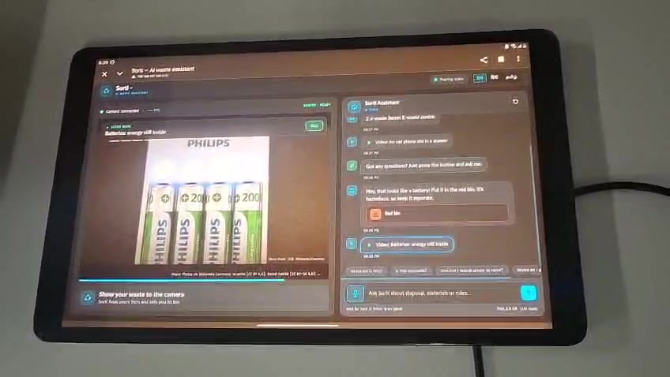
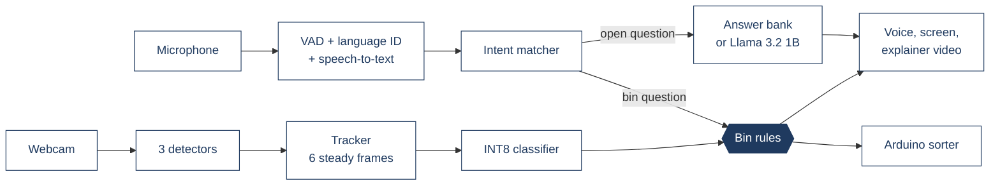
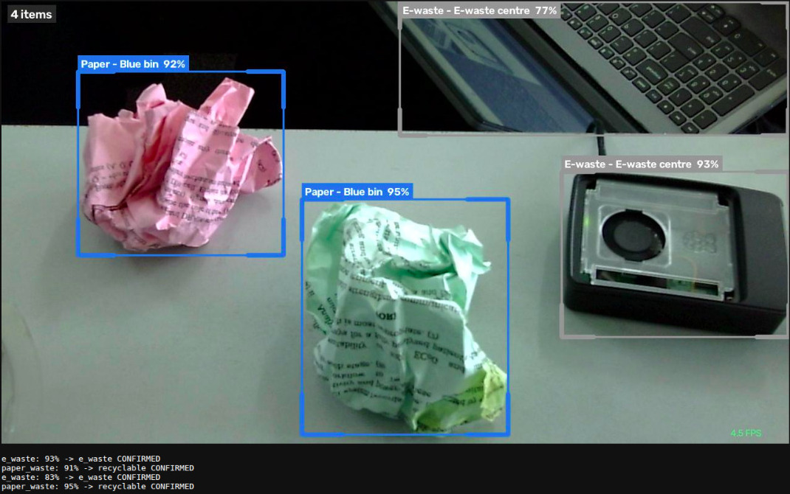
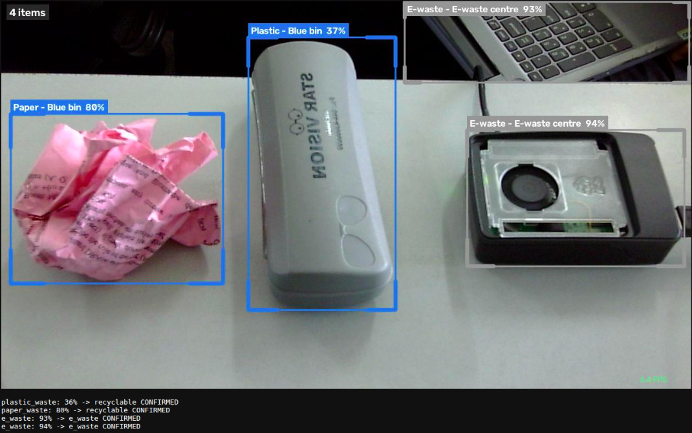

<div align="center">

# Sorti

**Offline, multilingual waste-sorting assistant on a CPU-only Raspberry Pi 5**

Bharat AI-SoC Student Challenge 2026–27 (Arm) · Problem Statement 2


[](https://github.com/dharshan188/arm_ps2/actions/workflows/ci.yml)

**[Final project report (PDF)](docs/reports/Sorti_Final_Project_Report.pdf)** · [Pi 5 test report](docs/reports/Sorti_RaspberryPi5_Test_Report.pdf) · [Benchmarks](docs/BENCHMARKS.md) · [Architecture](docs/ARCHITECTURE.md) · [Pi 5 setup](docs/SETUP_PI5.md)

</div>

<p align="center">


</p>

Put a piece of waste in front of the camera. Sorti finds every item, tells you which bin each one goes in, plays a short explainer, and answers spoken questions in English, Hindi or Tamil. An Arduino 2-servo sorter moves each confirmed item to its stream. Nothing goes to the cloud: every model runs on the Pi's four Cortex-A76 cores. We use no NPU, AI HAT or Hailo.

> **Built with Llama.** Free-form answers come from Meta Llama 3.2 1B Instruct, run on the device with ExecuTorch, under the [Llama 3.2 Community License](https://github.com/meta-llama/llama-models/blob/main/models/llama3_2/LICENSE).

## Results

Measured on the Raspberry Pi 5 on 19 Nov 2026 with the full app running (camera, 3 detectors, 2 classifiers, mic, speaker, Llama, translator, sorter). Source: [Pi 5 test report](docs/reports/Sorti_RaspberryPi5_Test_Report.pdf).

| Metric | Result |
|---|---|
| Correct bin, 540 held-out test images¹ | 95.2 % (93.9 % correct type) |
| Hazard + e-waste recall (battery, bulb, e-waste images) | 170 / 180 = 94.4 % |
| Classification time per item | 78 ms median, 92 ms p90 |
| Live camera with all 3 detectors | 2.8–4.8 FPS |
| Rule answer ("which bin?") | 0.13 s typical, 0.20 s worst |
| English Llama answer, first words / complete | 1.7 s / 6.3 s typical |
| Tamil / Hindi Llama answer (translate, answer, translate back) | ~19 s typical, 23.0 s worst |
| Speech-to-text, typical | en 0.71 s · ta 1.14 s · hi 1.85 s |
| Language understanding (intent + item) | 216/216 · held-out 27/27 · code-mixed 13/13 |
| App RAM, everything loaded | 3.89 GB (whole Pi 5.47–5.59 GB of 8.06 GB, no swap) |
| Arduino sort cycle | 5.8 s typical, 5/5 live sorts acknowledged |
| Power and temperature, full load | 5.07–5.18 V, no throttling, 70.8 °C |

<sub>¹ 60 images per type from the test split of `4w4kt/waste-dataset-image`, evaluated on the Pi with the live settings. The raw ensemble scores 94.1 % type / 95.6 % bin on the same images. These are dataset photos, not Pi-camera photos. Full table with sources: [docs/BENCHMARKS.md](docs/BENCHMARKS.md).</sub>

## PS2 requirements

| Requirement | Where Sorti meets it |
|---|---|
| Classify waste | 3 detectors + INT8 classifier ensemble, 9 waste types, several items per frame |
| Recommend disposal | Fixed rule table → green, yellow or red bin, or authorised e-waste collector |
| Explain recycling options | Spoken explanation per item; rule answers to "is it recyclable?" and "where do I give it?" |
| Promote sustainable practice | 9 real-photo explainers (41–62 s, en/hi/ta voice-over) that play on confirmation |
| Teach environmental impact | Explainers cover harm, who it affects, disposal and prevention; Llama answers open questions |
| Use Llama | Llama 3.2 1B Instruct (SpinQuant INT4) for free-form questions only |
| Use ExecuTorch | Llama and the 5 live vision models are `.pte` programs on ExecuTorch 1.3.1 + XNNPACK |
| Multimodal interface | Camera, always-on voice with language ID, typed chat, spoken replies, physical sorter |
| Hardware | Raspberry Pi 5 8 GB, CPU only |

## How it works



Vision and voice are two separate pipelines on the same CPU. They meet only at the bin rules. **A language model never decides a bin.** We added that rule after Llama put a used AA battery in the green bin during an early test.

| Stage | Model | Runtime |
|---|---|---|
| Object proposals | Waste-trained YOLO11n, COCO YOLO11n, YOLO-World (320 px) | ExecuTorch + XNNPACK |
| Classification | MobileNetV3-Large + MobileNetV4-Medium, dynamic INT8 | ExecuTorch + XNNPACK |
| Voice activity, language ID | Silero VAD, Whisper base INT8 | onnxruntime, sherpa-onnx |
| Speech-to-text | Moonshine (en), IndicConformer (hi, ta), INT8 | sherpa-onnx |
| Open questions | Verified answer bank, then Llama 3.2 1B SpinQuant INT4 | Python, ExecuTorch + XNNPACK |
| Translation (hi/ta ↔ en) | NLLB-200 distilled 600M, INT8 | CTranslate2 |
| Text-to-speech | Piper voices for en, hi, ta | piper-tts |

| Waste type | Stream | Bin |
|---|---|---|
| organic, paper | biodegradable | green |
| plastic, glass, metal, clothes | recyclable (dry) | yellow |
| batteries, light bulbs | hazardous | red |
| e-waste | e-waste | authorised collector |

The streams follow India's Solid Waste Management Rules, 2016 (wet, dry, domestic hazardous) and the E-Waste (Management) Rules, 2022. Bin colours live in one file, `lap/content.py`, so they can match local practice.

## Multi-object tracking

<p align="center">


</p>

Three detectors propose boxes and an IoU tracker keeps one identity per item. The ensemble classifies each crop. An item is confirmed after 6 steady frames that clear its class's confidence bar. The cardboard base is masked by colour, so it is never counted as an item. These frames are from an earlier laptop build (4.4–4.5 FPS), and its bin labels have since changed. On the Pi the live app runs at 2.8–4.8 FPS.

## Arm optimisations

| What we changed | Measured effect on the Pi |
|---|---|
| Llama system prompt prefilled into the KV cache while idle | First token 7.3 s → 0.85 s |
| NLLB output restricted to the target script's tokens, 2 threads | Translation 9.2 s → 3.5 s |
| Language ID encodes only the speech that VAD keeps | 1.12 s → 0.23 s |
| Llama 3.2 1B in SpinQuant INT4, in its own worker process | 1.57 GB resident; a worker crash falls back to a rule answer |
| Lazy load and idle unload of Llama and NLLB, RAM check before each load | 3.89 GB app peak, no swap |
| Vision paused while an answer is computed | All 4 cores go to speech and Llama during an answer |
| INT8 post-training quantisation of the classifier | 16.9 MB → 4.5 MB, macro-F1 0.944 → 0.929 |

On x86, INT8 ran slower than FP32 (16.1 vs 7.5 ms), so we chose INT8 for size and RAM on the Pi. We have not profiled KleidiAI kernels yet and claim no gain from them.

## Llama answer quality

We wrote 46 English kiosk questions and scored the answers with 7 automatic checks in [`score.py`](lap/llm_eval/score.py): no bin named, safe, complete, short, on topic, no known-wrong claim, no format echo. The runs used the Pi's Llama `.pte` on a laptop (Intel i3-1115G4), not the Pi itself.

| Setup | Useful answers | Who answered |
|---|---|---|
| Original prompt | 24/46 (52 %) | Llama 46 |
| New prompt and guards, Llama only | 36/46 (78 %) | Llama 44, fallback 1, redirect 1 |
| Shipped: verified answer bank + Llama + guards | 43/46 (93 %) | bank 37, Llama 8, redirect 1 |

The 93 % is a system score, not a model score: 37 answers come from the hand-checked bank. On 30 new paraphrases the bank matcher was right 24 times. The off-topic guard wrongly declined 0 of 15 unusual but valid questions and caught 9 of 10 off-topic ones. Details and raw results: [`lap/llm_eval/RESULTS.md`](lap/llm_eval/RESULTS.md).

## Quick start

Full Pi 5 walkthrough (speaker, mic, camera, Arduino, autostart): [docs/SETUP_PI5.md](docs/SETUP_PI5.md).

```bash
sudo apt install -y git curl bzip2 python3-venv python3-dev ffmpeg alsa-utils pulseaudio-utils v4l-utils
git clone https://github.com/dharshan188/arm_ps2.git ~/sorti && cd ~/sorti

python3 -m venv ~/ps2_et
~/ps2_et/bin/pip install torch==2.12.1 --index-url https://download.pytorch.org/whl/cpu
~/ps2_et/bin/pip install -r requirements.txt

./download_models.sh        # speech, VAD and translation models (~2.3 GB)
lap/run.sh                  # opens http://127.0.0.1:8000
lap/run.sh --lang ta        # start in Tamil (en | hi | ta)
```

- **Llama:** download the public [ExecuTorch Llama 3.2 1B SpinQuant INT4 export](https://huggingface.co/executorch-community/Llama-3.2-1B-Instruct-SpinQuant_INT4_EO8-ET). Save it as `llama/llama3_2_1b_spinquant_int4_xnnpack.pte`, with the tokenizer at `llama/checkpoint/tokenizer.model`. Without Llama, Sorti still answers every bin question.
- **Pinned versions:** torch 2.12.1+cpu, ExecuTorch 1.3.1 (built against torch 2.12, so keep torch on 2.12.x).
- **Requirements:** Raspberry Pi 5 (8 GB) with 64-bit Raspberry Pi OS, at least 8 GB free disk, USB webcam, USB mic and a speaker. An x86 Ubuntu laptop also works.
- **No camera or mic:** open `http://127.0.0.1:8000/?mock=1&lang=ta`.

## Reproduce the numbers

```bash
env -u PYTHONPATH ~/ps2_et/bin/python -m unittest vision.test_multi lap.test_multi_flow lap.test_faq
env -u PYTHONPATH ~/ps2_et/bin/python scripts/eval_testset.py          # vision accuracy, 540 test images
cd lap/llm_eval && env -u PYTHONPATH ~/ps2_et/bin/python score.py results_final.json   # Llama answers
```

## Repository

```
lap/        app: FastAPI server, kiosk web UI, answer bank, Llama eval, explainer videos
vision/     detectors, INT8 classifier ensemble, tracker, 540-image test set, benchmarks
voice/      intent matcher for en / hi / ta, speech benchmark
llama/      ExecuTorch Llama runner with KV-cache priming
translate/  NLLB-200 (downloaded) and per-language vocabulary maps
pi/         Raspberry Pi helper scripts
scripts/    eval_testset.py
docs/       reports (PDF), architecture, benchmarks, Pi setup, figures
```

## Limitations

- Tamil and Hindi open questions that miss the answer bank take about 19 s, because NLLB translates both ways on the CPU.
- Metal is the weakest class (81.7 %), mostly confused with plastic or e-waste.
- Speech accuracy was measured with synthetic voices. Real voices in a noisy room were tested only informally.
- The Arduino sketch is not in this repository. The serial protocol is in [docs/ARCHITECTURE.md](docs/ARCHITECTURE.md#5-arduino-sorter).

## Licence

Our code is MIT ([LICENSE](LICENSE)). Models, datasets, fonts and photos keep their own licences: NLLB-200 is CC-BY-NC-4.0, and the Ultralytics YOLO weights are AGPL-3.0. The full system is therefore for education and non-commercial use. See [THIRD_PARTY_LICENSES.md](THIRD_PARTY_LICENSES.md). Llama 3.2 is licensed under the Llama 3.2 Community License, Copyright © Meta Platforms, Inc. All Rights Reserved.

Team: [@dharshan188](https://github.com/dharshan188)
