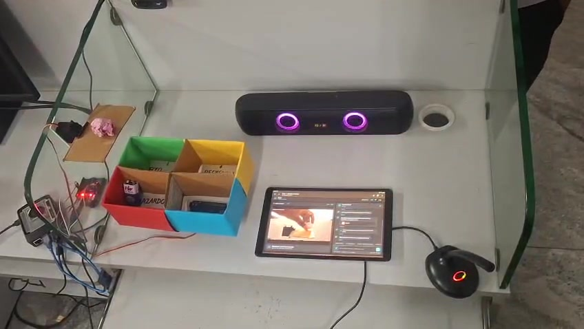
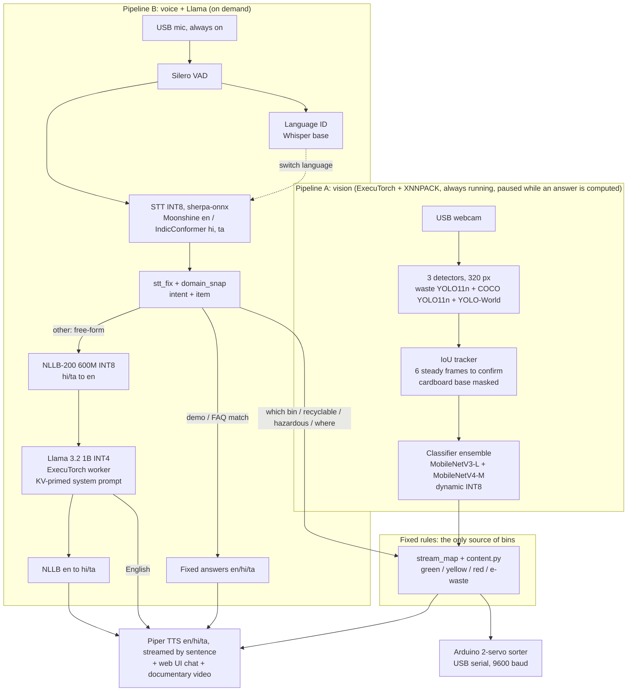
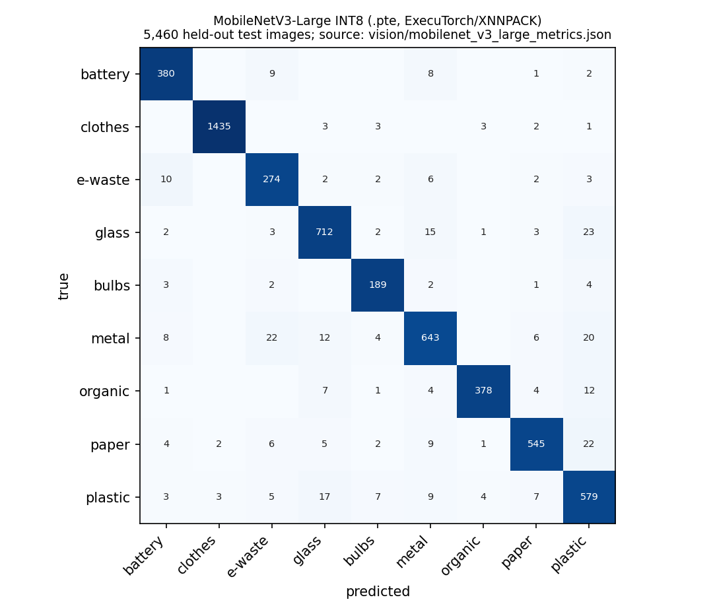

<div align="center">

# Sorti

### An offline waste-sorting assistant that sees, listens and talks, running entirely on a Raspberry Pi 5.

Show Sorti a piece of rubbish and it tells you which bin it goes in, explains why, plays a short documentary and answers your questions by voice in English, Hindi or Tamil. No cloud, no GPU and no internet: every model runs on the Arm Cortex-A76 CPU.

-C51A4A?logo=raspberrypi&logoColor=white)


-555555)


[](https://github.com/dharshan188/arm_ps2/actions/workflows/ci.yml)

**Bharat AI-SoC Student Challenge 2026–27 (Arm) · Problem Statement 2: Smart recycling & waste-segregation assistant using multimodal interfaces**

</div>

## Results at a glance

<table>
<tr>
<td align="center"><b>95.2 %</b><br/>correct bin<br/><sub>93.9 % type, live settings¹<br/>540 held-out test images<br/>(<a href="docs/reports/Sorti_RaspberryPi5_Test_Report.pdf">Pi report §2</a>)</sub></td>
<td align="center"><b>94.4 %</b><br/>hazard + e-waste recall<br/><sub>170 / 180 battery, bulb, e-waste images<br/>(<a href="docs/BENCHMARKS.md#hazard-recall">calculation</a>)</sub></td>
<td align="center"><b>78 ms</b><br/>vision per item, median<br/><sub>92 ms p90, live app<br/>(<a href="docs/reports/Sorti_RaspberryPi5_Test_Report.pdf">Pi report §2</a>)</sub></td>
<td align="center"><b>1.7 s / 6.3 s</b><br/>Llama first words / full answer<br/><sub>English, typical, on the Pi<br/>(<a href="docs/reports/Sorti_RaspberryPi5_Test_Report.pdf">Pi report §3</a>)</sub></td>
<td align="center"><b>0.13 s</b><br/>rule answer<br/><sub>0.20 s worst<br/>(<a href="docs/reports/Sorti_RaspberryPi5_Test_Report.pdf">Pi report §3</a>)</sub></td>
<td align="center"><b>3.89 GB</b><br/>peak app RAM<br/><sub>all models loaded, 0 swap<br/>(<a href="docs/reports/Sorti_RaspberryPi5_Test_Report.pdf">Pi report §1</a>)</sub></td>
</tr>
</table>

**Final project report (5 pages):** [`docs/reports/Sorti_Final_Project_Report.pdf`](docs/reports/Sorti_Final_Project_Report.pdf)

<sub>¹ 540 held-out dataset test images (60 per type), evaluated on the Pi 5 with the live app settings. The raw ensemble scores 94.1 % type / 95.6 % bin on the same images. The images come from the test split of the `4w4kt/waste-dataset-image` dataset; they are not Pi-camera photos.</sub>

Everything runs on a Raspberry Pi 5 (8 GB), CPU only: no NPU, no AI HAT, no Hailo. Every model runs on the four Arm Cortex-A76 cores through XNNPACK (Arm NEON kernels) or ONNX Runtime / CTranslate2 CPU kernels. The figures come from a live run with every component active. Each number in this README links to its source: the [Pi 5 test report](docs/reports/Sorti_RaspberryPi5_Test_Report.pdf), the [model accuracy report](docs/reports/Sorti_Model_Accuracy_Report.pdf) or [`docs/BENCHMARKS.md`](docs/BENCHMARKS.md).

> **Built with Llama.** Sorti uses Meta Llama 3.2 1B Instruct, run on-device with ExecuTorch, under the [Llama 3.2 Community License](https://github.com/meta-llama/llama-models/blob/main/models/llama3_2/LICENSE).

## PS2 requirements mapping

| PS2 requirement | How Sorti meets it |
|---|---|
| Identify / classify waste materials | 3 ExecuTorch detectors + an INT8 MobileNetV3-L / MobileNetV4-M ensemble classify every item in view into 9 waste types (+ general waste, background). 93.9 % type / 95.2 % bin on 540 held-out dataset test images evaluated on the Pi 5, live settings ([report](docs/reports/Sorti_RaspberryPi5_Test_Report.pdf)). |
| Recommend disposal methods | Fixed rule table → green / yellow / red bin or authorised e-waste collector, spoken and shown per item. An Arduino 2-servo sorter physically routes each confirmed item to its stream. |
| Explain recycling options | A spoken explanation per type (why this bin, preparation steps). Rule questions ("is it recyclable?", "where do I give it?") are answered in en / hi / ta. |
| Promote sustainable practice / education | 9 real-photo documentaries (41–62 s, en/hi/ta voice-over) ship in the repo and play when an item is confirmed. The full on-device library holds 50 videos (49 code-drawn explainers + 1 real clip). The explainer specs and renderer (`lap/videos/specs/`, `lap/videos/render.py`) are included; the rendered stick-figure clips are not committed. `lap/videos/index.json` in this repository lists only the 9 shipped documentaries. |
| Educate on environmental impact | Each documentary covers harm, who it affects, disposal and prevention, with sourced statistics. Llama answers open questions such as "how can I reduce plastic at home?". |
| Llama (advisory / reasoning) | Llama 3.2 1B Instruct, INT4, for free-form questions only. Bins never come from the LLM. |
| ExecuTorch on Arm | Llama and the 5 live vision models (3 detectors + 2 classifiers) are `.pte` programs on ExecuTorch 1.3.1 + XNNPACK on the Cortex-A76 CPU. |
| Multimodal interface | Camera + always-on voice (en / hi / ta, automatic language ID) + typed chat in a kiosk web UI + spoken replies + a physical sorter. |
| Hardware | Raspberry Pi 5 8 GB, CPU only (no AI HAT+ / Hailo). Vision and voice/LLM are separate pipelines on the same CPU (diagram below). |

---

## Contents

- [Demo](#demo)
- [Key results](#key-results-measured-on-the-raspberry-pi-5)
- [How it works](#how-it-works)
- [Multi-object tracking](#multi-object-tracking)
- [Vision accuracy](#vision-accuracy)
- [Offline and privacy](#offline-and-privacy)
- [Indian waste rules](#indian-waste-rules)
- [Arm optimisations](#arm-optimisations)
- [Llama answer quality](#llama-answer-quality)
- [Quick start](#quick-start)
- [Testing and reproducing the numbers](#testing-and-reproducing-the-numbers)
- [Repository layout](#repository-layout)
- [Known limitations](#known-limitations)
- [Lessons learned](#lessons-learned)
- [Comparison with typical approaches](#comparison-with-typical-approaches)
- [Phase 2 roadmap](#phase-2-roadmap)
- [Documentation](#documentation)
- [Licences](#licences)
- [Team and acknowledgements](#team-and-acknowledgements)

---

## Demo

<p align="center">


</p>
<p align="center"><sub>Left: the kiosk (four-compartment bin with the Arduino 2-servo sorter, Bluetooth speaker, USB microphone, display). Right: a battery recognised live and sent to the red (hazardous) bin.</sub></p>

| Step | What happens |
|---|---|
| 1. Place items on the base | Three detectors and a two-model classifier ensemble find every item in the frame and draw one bin-coloured box per item. |
| 2. Sorti confirms | After 6 steady frames an item is confirmed. Sorti names it and its bin ("Plastic! Yellow bin."), and the Arduino 2-servo sorter receives one command per item. |
| 3. Learn | A 41–62 s real-photo documentary for that waste type plays with an en/hi/ta voice-over. |
| 4. Ask | The microphone is always on. Ask "which bin does this go in?", "is it dangerous?", "எந்த பின்ல போடணும்?" or "किस बिन में डालूँ?". Bin questions are answered by fixed rules in about 0.13 s. Open questions ("how can I use less plastic at home?") go to Llama 3.2 1B. |

Bins used by Sorti:

| Waste type | Stream | Bin |
|---|---|---|
| organic, paper | biodegradable | green |
| plastic, glass, metal, clothes | recyclable (dry) | yellow |
| batteries, light bulbs | hazardous | red |
| e-waste | e-waste | authorised e-waste collector |

The bin always comes from a fixed rule table (`vision/v2_taught/labels.json` `stream_map` plus `lap/content.py`). A language model never decides a bin.

Mock UI without camera or microphone: start the app and open `http://127.0.0.1:8000/?mock=1&lang=ta`.

---

## Key results (measured on the Raspberry Pi 5)

All numbers were measured on a Raspberry Pi 5 (8 GB) on 19 Nov 2026 with the full app running live: camera, 3 detectors, 2 classifiers, always-on mic, Bluetooth speaker, Llama 3.2 1B, NLLB translator and the Arduino sorter. Source: [`docs/reports/Sorti_RaspberryPi5_Test_Report.pdf`](docs/reports/Sorti_RaspberryPi5_Test_Report.pdf). See [`docs/BENCHMARKS.md`](docs/BENCHMARKS.md) for every figure and its source.

| Metric | Result | Source |
|---|---|---|
| Waste-type accuracy, 540 held-out dataset test images (60/type), evaluated on the Pi 5 | **93.9 %** (live settings)¹ | [Pi report §2](docs/reports/Sorti_RaspberryPi5_Test_Report.pdf) |
| Correct-bin accuracy, same 540 images | **95.2 %** (live settings)¹ | [Pi report §2](docs/reports/Sorti_RaspberryPi5_Test_Report.pdf) |
| Classification time per item, live app | 78 ms median, 92 ms p90 | [Pi report §2](docs/reports/Sorti_RaspberryPi5_Test_Report.pdf) |
| Live camera with all 3 detectors | 2.8–4.8 FPS | [Pi report §2](docs/reports/Sorti_RaspberryPi5_Test_Report.pdf) |
| App RAM with everything loaded (server + Llama worker) | **3.89 GB** (2.32 GB + 1.57 GB) | [Pi report §1](docs/reports/Sorti_RaspberryPi5_Test_Report.pdf) |
| Whole Pi RAM with everything loaded | 5.47–5.59 GB of 8.06 GB, swap 0 MB | [Pi report §1](docs/reports/Sorti_RaspberryPi5_Test_Report.pdf) |
| Rule answer (which bin / recyclable / hazardous) | **0.13 s** typical, 0.20 s worst | [Pi report §3](docs/reports/Sorti_RaspberryPi5_Test_Report.pdf) |
| Speech-to-text (typical / worst) | en 0.71 / 0.91 s · ta 1.14 / 1.48 s · hi 1.85 / 1.85 s | [Pi report §3](docs/reports/Sorti_RaspberryPi5_Test_Report.pdf) |
| English Llama answer: first words / complete | 1.7 s / 6.3 s typical (2.0 s / 6.5 s worst) | [Pi report §3](docs/reports/Sorti_RaspberryPi5_Test_Report.pdf) |
| Tamil / Hindi Llama answer (NLLB → Llama → NLLB) | ~19 s typical, 23.0 s worst | [Pi report §3](docs/reports/Sorti_RaspberryPi5_Test_Report.pdf) |
| Language understanding (intent + item) | **216/216** (72 en + 72 hi + 72 ta) · held-out 27/27 · code-mixed 13/13 | [Pi report §4](docs/reports/Sorti_RaspberryPi5_Test_Report.pdf) |
| Language ID on spoken questions (synthetic voices) | 15/15 | [Pi report §4](docs/reports/Sorti_RaspberryPi5_Test_Report.pdf) |
| Arduino sort cycle | 5.8 s typical, 5.9 s worst (5/5 live sorts acknowledged) | [Pi report §5](docs/reports/Sorti_RaspberryPi5_Test_Report.pdf) |
| Power and temperature, full load | 5.07–5.18 V, no under-voltage or throttling flags, 70.8 °C | [Pi report summary](docs/reports/Sorti_RaspberryPi5_Test_Report.pdf) |

---

## How it works

Two independent pipelines share the Pi's CPU. They meet only at the fixed rule table, which decides every bin.



| Stage | Model | Runtime | Precision |
|---|---|---|---|
| Object proposals | YOLO11n trained on waste, YOLO11n (COCO), YOLO-World (23 waste prompts), 320 px | ExecuTorch + XNNPACK | FP32 |
| Classification | MobileNetV3-Large + MobileNetV4-Conv-Medium ensemble, 11 classes (9 waste types + general + background) | ExecuTorch + XNNPACK | dynamic INT8 |
| Voice activity | Silero VAD | onnxruntime | FP32 |
| Language ID | Whisper base, language-token logits pooled to en / hi / ta | sherpa-onnx | INT8 |
| Speech-to-text | Moonshine base (en), AI4Bharat IndicConformer 120M CTC (hi, ta) | sherpa-onnx | INT8 |
| Understanding | `voice/domain_snap.py`: fuzzy + phonetic keyword matching, code-mix aware | Python (rapidfuzz) | n/a |
| Free-form answers | Llama 3.2 1B Instruct, SpinQuant INT4_EO8 (QLoRA INT4 also supported) | ExecuTorch + XNNPACK | INT4 weights, INT8 dynamic activations |
| Translation | NLLB-200 distilled 600M | CTranslate2 | INT8 |
| Text-to-speech | Piper: lessac (en), pratham (hi), AI4Bharat Rasa female (ta) | piper-tts (onnxruntime) | ONNX FP32 |

The browser is only a screen. `lap/server.py` (FastAPI) owns the camera, microphone, speaker and serial port, as a kiosk would. Full details: [`docs/ARCHITECTURE.md`](docs/ARCHITECTURE.md).

---

## Multi-object tracking

Sorti handles several items on a table at once, as well as a single item held up to the camera. Three detectors propose boxes. An IoU tracker keeps one identity per item, and each crop is classified by the INT8 ensemble. An item is confirmed only after 6 steady frames that clear a per-class confidence bar. The cardboard sorting base is recognised by colour and never counted as an item.

<p align="center">


</p>

*Live multi-object detection and tracking with 4 items confirmed, at 4.4–4.5 FPS on the development laptop. On the Raspberry Pi 5 the live app runs at 2.8–4.8 FPS with all three detectors ([Pi report §2](docs/reports/Sorti_RaspberryPi5_Test_Report.pdf)). These frames come from an earlier laptop build: the on-screen bin labels have since changed, with recyclables now spoken as the yellow bin and paper routed to the green (biodegradable) bin.*

---

## Vision accuracy

Shipped ensemble, evaluated on the Pi 5 ([Pi report §2](docs/reports/Sorti_RaspberryPi5_Test_Report.pdf)): 93.9 % type / 95.2 % bin with the live settings on 540 held-out dataset test images (60 per type) from the test split of `4w4kt/waste-dataset-image`. These are not Pi-camera photos. The raw ensemble without the live paper/clothes weighting scores 94.1 % / 95.6 %. In this repository's training script (`vision/train/fast_head.py`), `pi_testset` is assigned to the test split only, and byte-identical copies are removed from training. The owner-item fine-tuning of the v2 models was done outside this repository, so their exclusion of these files cannot be independently verified here. The per-type table is in [`docs/BENCHMARKS.md`](docs/BENCHMARKS.md#vision-accuracy-on-visionpi_testset-540-images-60-per-type). Safety-relevant classes:

| Held-out test set on the Pi, correct bin | Battery | Light bulbs | E-waste | Combined |
|---|---|---|---|---|
| Images | 60 | 60 | 60 | 180 |
| Correct bin | 95.0 % | 98.3 % | 90.0 % | **170 / 180 = 94.4 %** |

v1 single model, held-out test set (MobileNetV3-L INT8 `.pte`, 5,460 images; source [`vision/mobilenet_v3_large_metrics.json`](vision/mobilenet_v3_large_metrics.json) and the [accuracy report](docs/reports/Sorti_Model_Accuracy_Report.pdf)): accuracy 94.0 %, macro-F1 0.929 (9 classes), stream accuracy 97.0 %, hazardous-stream recall 572 / 601 = 95.2 %, e-waste-stream recall 274 / 299 = 91.6 %.

<p align="center"></p>

| Class | Test images | Precision | Recall | F1 |
|---|---|---|---|---|
| battery | 400 | 0.925 | 0.950 | 0.937 |
| clothes | 1,447 | 0.997 | 0.992 | 0.994 |
| e-waste | 299 | 0.854 | 0.916 | 0.884 |
| glass | 761 | 0.939 | 0.936 | 0.937 |
| light bulbs | 201 | 0.900 | 0.940 | 0.920 |
| metal | 715 | 0.924 | 0.899 | 0.911 |
| organic | 407 | 0.977 | 0.929 | 0.952 |
| paper | 596 | 0.954 | 0.914 | 0.934 |
| plastic | 634 | 0.869 | 0.913 | 0.891 |
| **macro** | **5,460** | **0.926** | **0.932** | **0.929** |

Precision, recall and F1 are computed from the confusion matrix stored in the metrics file.

---

## Offline and privacy

- **No network at runtime.** The UI is served from `lap/web/` with local fonts and inline SVG: no CDNs, no Google Fonts, no analytics. Every model is a local file loaded from `vision/`, `voice/`, `translate/` and `llama/`. Network is needed only once, to run `download_models.sh` and fetch Llama.
- **Camera frames and audio never leave the device.** Frames are processed in memory and streamed only to the local UI (`/video`). Utterances are decoded in RAM. Nothing is uploaded or logged to a remote service.
- **Check it yourself:**

  ```bash
  nmcli networking off            # or: sudo ip link set wlan0 down && sudo ip link set eth0 down
  lap/run.sh --lang en            # open http://127.0.0.1:8000 on the Pi itself
  # place an item, ask "which bin?" and an open question: everything still works
  ss -tunp | grep -v 127.0.0.1    # with networking off there are no outbound sockets
  nmcli networking on
  ```

  When the UI is opened from another device (`--host 0.0.0.0`), the camera preview is visible to anyone who can reach that LAN port. Bind to `127.0.0.1` on shared networks.

---

## Indian waste rules

Sorti's categories follow the source-segregation idea of India's Solid Waste Management Rules, 2016: households separate waste into biodegradable (wet), non-biodegradable (dry) and domestic hazardous waste. E-waste is handled separately and goes to authorised collection and recycling channels under the E-Waste (Management) Rules, 2022.

| Sorti stream | Items | Bin colour used in Sorti |
|---|---|---|
| Biodegradable (wet) | food and garden waste, paper | green |
| Dry / recyclable | plastic, glass, metal, clothes | yellow |
| Domestic hazardous | batteries, light bulbs / tubes | red |
| E-waste | phones, chargers, cables, electronics | authorised e-waste collector |

Bin colours and collection practice vary between municipalities. The colours live in one file (`lap/content.py`) and can be changed to match local rules. Sorti gives sorting guidance, not legal advice.

---

## Arm optimisations

With everything loaded Sorti runs eleven neural networks at once: 3 detectors, 2 classifiers, VAD, language ID, STT, TTS, Llama and NLLB. They have to fit into 8 GB of RAM on four Cortex-A76 cores and still answer bin questions without a noticeable delay. The table lists what we changed and the measured effect.

| Optimisation | Effect (measured) |
|---|---|
| **INT8 post-training quantisation.** The first classifier, MobileNetV3-L, went from 16.9 MB to 4.5 MB with PT2E per-channel INT8 and was fully delegated to XNNPACK (1 delegate call). | Macro-F1 0.944 → 0.929 for a 3.7× smaller model. MobileNetV3-Small collapsed under INT8 (F1 0.288) and QAT (0.915) did not beat PTQ, so PTQ MobileNetV3-L shipped ([accuracy report](docs/reports/Sorti_Model_Accuracy_Report.pdf)). |
| **INT8 speed on x86.** On the x86 Colab CPU, INT8 was slower than FP32 (16.1 vs 7.5 ms p50, `vision/mobilenet_v3_large_metrics.json` `host_bench_NOT_PI`). | INT8 was chosen for size and RAM on the Pi (4.5 vs 16.9 MB; model RSS 10.7 vs 25.5 MB on the same host). A portable-vs-XNNPACK and thread-count profile on the Pi is Phase 2. No KleidiAI-specific gains are claimed. |
| **Dynamic-INT8 ensemble** (MobileNetV3-L + MobileNetV4-M) for the multi-object pipeline. | 93.9 % type / 95.2 % bin (live settings) on 540 held-out test images on the Pi, 78 ms median per item in the live app ([Pi report §2](docs/reports/Sorti_RaspberryPi5_Test_Report.pdf)). |
| **Llama 3.2 1B in INT4** (SpinQuant INT4_EO8: 4-bit groupwise linear weights, 8-bit embedding/output, 8-bit dynamic activations) on ExecuTorch + XNNPACK, run in a separate persistent worker process. | 1.57 GB resident ([Pi report §1](docs/reports/Sorti_RaspberryPi5_Test_Report.pdf)). The worker isolates the app from runtime crashes. A worker failure falls back to a rule answer. |
| **KV-cache system-prompt priming.** The long system prompt is prefilled into the KV cache while the app is idle and re-primed after each answer, so a question prefills only its own tokens. | Llama first token 7.3 s → 0.85 s (idle) ([Pi report §3](docs/reports/Sorti_RaspberryPi5_Test_Report.pdf)). |
| **NLLB per-language vocabulary map.** The 256k-token output vocabulary is restricted to the target script's tokens, with beam 1 and 2 threads. | Translation 9.2 s → 3.5 s (idle) ([Pi report §3](docs/reports/Sorti_RaspberryPi5_Test_Report.pdf)). |
| **Language ID on speech only.** VAD trims the window so Whisper encodes only the speech. | 1.12 s → 0.23 s (idle) ([Pi report §3](docs/reports/Sorti_RaspberryPi5_Test_Report.pdf)). |
| **Lazy load / unload RAM governor.** Llama (~1.9 GB budget) and NLLB (~1.0 GB) load on first use. Before each load the server checks `MemAvailable` plus a margin, unloads the other heavy model if needed and unloads idle models. Only the active language's STT and TTS are kept in memory. | Worst case 3.89 GB app RSS, whole Pi 5.6 GB of 8 GB, 0 MB swap ([Pi report §1](docs/reports/Sorti_RaspberryPi5_Test_Report.pdf)). |
| **Vision paused while an answer is computed**, so all four cores go to STT, Llama or NLLB. | The camera keeps tracking between answers; answer latency is not shared with the detectors. |
| **Sentence-by-sentence streaming TTS** and streamed Llama tokens. | First sound on a 460-character reply 5.4 s → 0.4 s (laptop, development notes; [benchmarks](docs/BENCHMARKS.md#development-laptop-measurements)). English Llama first words on screen in 1.7 s on the Pi ([Pi report §3](docs/reports/Sorti_RaspberryPi5_Test_Report.pdf)). |
| **Piper Tamil voice instead of Meta MMS.** | 4 Tamil lines synthesised in 2.4 s instead of 14.5 s, about 400 MB less RAM (laptop, development notes; [benchmarks](docs/BENCHMARKS.md#development-laptop-measurements)). |

---

## Llama answer quality

Source: [`lap/llm_eval/RESULTS.md`](lap/llm_eval/RESULTS.md). The raw results are in the `lap/llm_eval/results_*.json` files.

- **Setup:** 46 English free-form questions written by the team. Device: laptop (Intel i3-1115G4), not the Pi. Model: the same Llama 3.2 1B SpinQuant INT4 `.pte` run through the app's own worker, with greedy decoding.
- **Scoring:** "useful" means the answer passes all 7 automatic regex / keyword checks in `lap/llm_eval/score.py`: no bin named, safe, complete, short, on topic, no known-wrong claim, no format echo. These are not human ratings.

| Configuration | Useful | Who answered |
|---|---|---|
| Baseline (old prompt) | 24/46 (52 %) | Llama 46 |
| Llama only: new prompt, off-topic guard and answer guard; no verbatim bank answers | **36/46 (78 %)** | Llama 44, bank fallback 1, redirect 1 |
| Shipped system: verified answer bank + Llama + guards | 43/46 (93 %) | bank 37, Llama 8, redirect 1 |

**The 93 % is not a Llama score.** In the shipped system, 37 of the 46 answers are hand-written, verified bank text. The model's own score is the Llama-only row, which rose from 52 % to 78 % with the new prompt and decoding settings. Adding an answer-bank fact to the prompt did not help (35/46), so that option is off.

| Held-out / guard check | Result |
|---|---|
| Bank matcher on 30 new paraphrases | 24/30 decided correctly; precision of verbatim answers 17/18 |
| Off-topic guard, 15 legitimate but unusual questions | 0/15 wrongly declined |
| Off-topic guard, 10 off-topic questions | 9/10 caught with an item on camera |
| Hindi / Tamil questions that get a verified native-language bank answer | Hindi 15/17, Tamil 11/18 (their Llama answers were not scored) |

Latency on the laptop: 1.50 s average for the Llama answers in the shipped system, generated from a primed KV cache. For measured Pi answer times, see [Key results](#key-results-measured-on-the-raspberry-pi-5). These are in-sample results: the team wrote the questions, the bank and the scorer. The held-out table is the generalisation check.

---

## Quick start

> Full Raspberry Pi 5 walkthrough, including Bluetooth speaker, USB mic, camera, Arduino and autostart: [`docs/SETUP_PI5.md`](docs/SETUP_PI5.md).

### Requirements

| | |
|---|---|
| Board | Raspberry Pi 5 (8 GB), 64-bit Raspberry Pi OS, official 27 W PSU and active cooler. An x86-64 Ubuntu 22.04+ laptop also works as a stand-in. |
| Peripherals | USB webcam, USB microphone, speaker (Bluetooth or wired). Arduino 2-servo sorter is optional. |
| Disk | at least 8 GB free (see docs/SETUP_PI5.md) |
| Python | 3.10 or newer (Pi tested with 3.13, laptop with 3.10) |

### 1. Clone and create the environment

```bash
sudo apt update
sudo apt install -y git curl bzip2 python3-venv python3-dev ffmpeg alsa-utils pulseaudio-utils v4l-utils

git clone https://github.com/dharshan188/arm_ps2.git ~/sorti && cd ~/sorti

python3 -m venv ~/ps2_et
~/ps2_et/bin/pip install --upgrade pip
# install torch from the CPU index (otherwise pip pulls ~3 GB of CUDA libraries) and keep it on 2.12.x
~/ps2_et/bin/pip install torch==2.12.1 --index-url https://download.pytorch.org/whl/cpu
~/ps2_et/bin/pip install -r requirements.txt
```

The scripts expect the virtual environment at `~/ps2_et`. Always run Python as `env -u PYTHONPATH ~/ps2_et/bin/python ...` so that a ROS or other workspace on `PYTHONPATH` can't leak in. `lap/run.sh` already does this.

### 2. Download the models

The vision models (`vision/v2_taught/`, `vision/det/`) are in the repo. Speech, VAD and translation models (about 2.3 GB) come from their original public sources:

```bash
./download_models.sh          # re-runnable, skips files that already exist
```

| Fetched by `download_models.sh` | Destination |
|---|---|
| Moonshine base en INT8 (sherpa-onnx release) | `voice/stt_moonshine_base_en/` |
| Whisper base INT8, for language ID | `voice/stt_whisper_base_en/` |
| IndicConformer hi + ta INT8 | `voice/stt_indicconformer_{hi,ta}/` |
| Silero VAD | `voice/vad/` |
| Piper voices en / hi / ta | `voice/tts_piper_{en,hi,ta_female}/` |
| NLLB-200 600M CTranslate2 INT8 | `translate/nllb_600m_ct2_int8/` |

**Llama (optional, for free-form questions).** Without it Sorti still answers every bin question. Two routes:

- **Raspberry Pi (used for the reported numbers):** download the public ExecuTorch [Llama 3.2 1B SpinQuant INT4 export](https://huggingface.co/executorch-community/Llama-3.2-1B-Instruct-SpinQuant_INT4_EO8-ET). Save the `.pte` as `llama/llama3_2_1b_spinquant_int4_xnnpack.pte` and the tokenizer as `llama/checkpoint/tokenizer.model`. See [`docs/SETUP_PI5.md`](docs/SETUP_PI5.md#5-llama-32-1b-optional).
- **Laptop:** accept Meta's licence for `meta-llama/Llama-3.2-1B-Instruct-QLORA_INT4_EO8`, run `~/ps2_et/bin/hf auth login`, then `llama/setup_llama.sh`. It downloads and exports QLoRA INT4 to `llama/llama3_2_1b_qlora_int4_xnnpack.pte`. This needs about 6.5 GB of free RAM and takes about 6 minutes.

The server picks QLoRA if present, else SpinQuant. `SORTI_LLAMA_PTE=/path/model.pte` overrides both.

### 3. Run

```bash
lap/run.sh                                  # laptop: opens http://127.0.0.1:8000
lap/run.sh --lang ta                        # start in Tamil (en | hi | ta)
lap/run.sh --camera 1 --mic USB             # pick webcam index and mic (substring of the PulseAudio source)
lap/run.sh --host 0.0.0.0 --no-speaker      # Pi, viewed from another device; replies as text
```

Ask a typed question while the server runs:

```bash
curl -s -X POST localhost:8000/api/ask/text -H 'Content-Type: application/json' \
     -d '{"text":"which bin for a battery"}'
```

Stop with Ctrl+C. If you run the server in the background, kill it by PID, never with `pkill -f server.py` from a shell whose own command line contains that text.

---

## Testing and reproducing the numbers

Pinned software stack for every number in this repository: Python 3.13 (Pi) / 3.10 (laptop), torch 2.12.1+cpu, ExecuTorch 1.3.1, torchao 0.18.0, sherpa-onnx 2.0.1, piper-tts 1.8.0, onnxruntime 1.23.2, CTranslate2 4.9.0 (full list in [`requirements.txt`](requirements.txt)). Torch must stay on 2.12.x, because ExecuTorch 1.3.1 is built against it.

```bash
# unit / integration tests (no models, camera or audio needed): 17 + 13 tests
env -u PYTHONPATH ~/ps2_et/bin/python -m unittest vision.test_multi lap.test_multi_flow
env -u PYTHONPATH ~/ps2_et/bin/python -m unittest discover -s lap/stt_eval -p 'test_*.py'

# vision accuracy of the shipped ensemble on the 540 held-out test images (raw ensemble, no live weighting)
env -u PYTHONPATH ~/ps2_et/bin/python scripts/eval_testset.py

# single-model latency / RAM / CPU / temperature benchmark (Pi), v1 MobileNetV3-L INT8
cd vision && env -u PYTHONPATH ~/ps2_et/bin/python pi_benchmark.py \
    --pte mobilenet_v3_large_int8_xnnpack.pte --labels labels.json --testdir pi_testset --runs 300

# live multi-object pipeline benchmark on a video or camera, no audio
env -u PYTHONPATH ~/ps2_et/bin/python vision/pi_stream.py --video vision/testvideo/sorti_test_40s.mp4 --benchmark

# speech-to-text evaluation set (see lap/stt_eval/README.md)
env -u PYTHONPATH ~/ps2_et/bin/python lap/stt_eval/eval.py en voice/stt_moonshine_base_en
```

`scripts/eval_testset.py` scores the raw ensemble. It gave 94.3 % type / 95.7 % bin on an x86 laptop during repository preparation; the same models scored 94.1 % / 95.6 % raw on the Pi 5 (93.9 % / 95.2 % with the live settings).

CI ([`.github/workflows/ci.yml`](.github/workflows/ci.yml)) runs lightweight checks only: a syntax check of every Python file, `ruff` with a lenient rule set and `bash -n` on the shell scripts. It never downloads models.

---

## Repository layout

```
.
├── README.md                     you are here
├── download_models.sh            fetches speech / VAD / translation models from their original sources
├── requirements.txt              pinned Python packages (install torch 2.12.1 CPU first)
├── lap/                          the app: FastAPI server + offline kiosk web UI
│   ├── run.sh                    start here
│   ├── server.py                 camera, mic, speaker, Arduino, RAM governor, all answer logic
│   ├── content.py                every spoken / UI sentence in en, hi, ta; bin wording
│   ├── lid.py                    language ID (Whisper base logits pooled to en/hi/ta)
│   ├── stt_fix.py                context-gated ASR corrections (west → waste, bean → bin)
│   ├── tts_utils.py              pause tightening for fluent TTS
│   ├── faq.py, faq_bank.json     verified answer bank (en/hi/ta), off-topic guard, answer guard
│   ├── llm_eval/                 Llama answer-quality eval: questions, score.py, raw results, RESULTS.md
│   ├── test_multi_flow.py        server rules / announcement tests (no models)
│   ├── web/                      index.html, sorti.css, sorti.js, local fonts (no CDNs)
│   ├── audio/                    cached welcome prompts
│   ├── stt_eval/                 STT benchmark set, scripts and results (REPORT.md, INDIC_REPORT.md)
│   └── videos/                   9 real-photo documentaries (en/hi/ta) + renderer, specs, photo credits
├── vision/
│   ├── v2_taught/                shipped classifier ensemble (dynamic INT8 .pte) + labels.json (stream_map)
│   ├── det/                      3 detector .pte files + export script
│   ├── multi.py                  detectors → tracker → classifier, per-class confirmation
│   ├── detector.py, base_zone.py YOLO decode / NMS, cardboard-base masking
│   ├── sorti_model.py            ensemble loader + preprocessing
│   ├── pi_stream.py              vision-only live view / benchmark
│   ├── pi_benchmark.py           Pi latency / RAM / accuracy benchmark
│   ├── pi_testset/               540 held-out dataset test images (60 per type)
│   ├── train/                    training / export scripts (v1 classifier)
│   ├── testvideo/                synthetic photo-composite stress-test video + evaluator
│   └── *.pte, *_metrics.json     v1 single-model INT8 classifiers and their metrics
├── voice/
│   ├── domain_snap.py            intent + item matcher for en / hi / ta, including code-mixed speech
│   └── speech_bench.py           STT / TTS benchmark harness
├── llama/
│   ├── chat.py                   ExecuTorch Llama runner + persistent worker with KV-cache priming
│   └── setup_llama.sh            QLoRA INT4 download + export
├── translate/                    NLLB-200 model folder (downloaded); per-language vocabulary maps built here
├── pi/                           Pi helpers: Bluetooth speaker, vision-only service scripts
├── scripts/eval_testset.py       reproduces the 540-image vision accuracy
└── docs/
    ├── ARCHITECTURE.md           components, data flow, API, RAM governor
    ├── BENCHMARKS.md             every number, with its source
    ├── SETUP_PI5.md              step-by-step Raspberry Pi 5 deployment
    ├── design/                   UI design system and layout mock-up
    ├── images/                   figures used in this README
    └── reports/                  Pi 5 test report and model accuracy report (PDF)
LICENSE                           MIT, for our code
THIRD_PARTY_LICENSES.md           licences of models, datasets, fonts, photos and libraries
.github/workflows/ci.yml          lightweight CI (syntax, ruff, shell, JSON), no models
```

---

## Known limitations

- **Tamil and Hindi free-form answers are slow** (about 19 s typical, up to 23 s), because NLLB translates both the question and the answer on the CPU. Bin questions and the fixed FAQ answers are fast in every language.
- **Llama 3.2 1B is small.** Its answers are usually sensible but sometimes odd. In one test it suggested newspaper as a fabric dye. It is never allowed to decide a bin. In scene-based reuse ("DIY") questions it is consulted only for confirmed recyclable materials, and the fixed sorting rules are appended for hazardous and organic items, after an early test produced unsafe reuse ideas for a bulb.
- **Metal is the weakest class** (81.7 % on the held-out test set), mostly confused with plastic or e-waste. Crumpled paper can look like cloth, so paper is weighted up in the live app and cloth may sometimes read as paper.
- **Speech accuracy was measured with synthetic voices** (Piper / MMS plus added noise). Real voices in a noisy room were tested only informally.
- **The vision test sets are mostly single items on clean backgrounds.** Cluttered scenes score lower.
- **Arduino:** the board dropped off USB once while the servos moved. Power the servos from a separate 5 V supply. The Arduino sketch is not in this repository. The serial protocol is documented in [`docs/ARCHITECTURE.md`](docs/ARCHITECTURE.md#5-arduino-sorter).
- **Licences:** NLLB-200 is CC-BY-NC-4.0 and the YOLO detectors come from AGPL-3.0 Ultralytics models, so the complete system as shipped is for non-commercial, educational use. See [`THIRD_PARTY_LICENSES.md`](THIRD_PARTY_LICENSES.md).

---

## Lessons learned

- **Quantisation has to be validated per architecture.** MobileNetV3-Small lost almost all its accuracy under full INT8 (F1 0.910 → 0.288) while MobileNetV3-Large lost 1.5 points. Always score the exported `.pte`, not the training model.
- **Keep the LLM out of safety decisions.** In an early test the 1B model put a used AA battery in the green bin. From then on, bins came only from the rule table and Llama only explains.
- **On a CPU-only board, idle-time work and scheduling matter as much as the model.** Priming the KV cache (7.3 s → 0.85 s), restricting the translator's vocabulary (9.2 s → 3.5 s), pausing vision during answers and streaming TTS cut latency with no change to model weights.
- **Isolate the native LLM runtime.** Running Llama in its own worker turned a crash that killed the app (SIGSEGV) into a rule-answer fallback.
- **A small model cannot speak every language.** Llama 3.2 does not officially support Tamil; a 1B model translated a Tamil question about reducing plastic as "basketball". NLLB translation around an English-only Llama, plus pre-written en/hi/ta rule text, fixed that.
- **Measure on the device, with everything running.** Colab and laptop numbers were useful for choosing models but did not predict Pi behaviour under full load. Every headline number here comes from the live Pi run.
- **Fix the audio front end before blaming STT.** On the development laptop, mic gain at 100 % gave a noise floor as loud as speech (RMS 0.18 vs about 0.03 at 60 %). On the Pi's USB mic, room noise measured 0.248 RMS at 60 % gain and 0.045 at the lowest gain, so the lowest gain is used. VAD and context-gated ASR fixes (west → waste, bean → bin) were added on top.

---

## Comparison with typical approaches

| Aspect | Typical single-model waste classifier | Sorti |
|---|---|---|
| Items per frame | one, centre crop | many: 3 detectors + tracker, one confirmed box per item |
| Who decides the bin | classifier label or LLM text | fixed rule table only; the LLM never decides a bin |
| Languages | English, text | English, Hindi and Tamil by voice, with automatic language ID and code-mix handling |
| LLM deployment | cloud API or desktop GPU | Llama 3.2 1B INT4 on ExecuTorch, on the Pi's CPU |
| Memory management | everything loaded at start | lazy load / idle unload governor, active-language-only speech models |
| Education | static text | 41–62 s documentaries with en/hi/ta voice-over |
| Physical action | none | Arduino 2-servo sorter driven per confirmed item |
| Evidence | accuracy on a public test split | per-class held-out test set evaluated on the Pi, live latency, RAM and thermal measurements on the target board |

---

## Phase 2 roadmap

- **Extend the Llama answer-quality evaluation** (today: 46 English questions on the laptop, automatic checks) to Hindi and Tamil, run it on the Pi, and add human rating on top of the automatic checks (see [Llama answer quality](#llama-answer-quality)).
- **Faster Tamil / Hindi free-form answers:** pre-generate and cache explanations, or use a smaller distilled translator, to bring the ~19 s path down.
- **Real-voice evaluation** in a noisy room, with recorded en/hi/ta speakers instead of synthetic voices.
- **More Indian household photos** for the weakest classes (metal 81.7 %, e-waste 90 %), plus a confusion matrix and hazard recall on a larger held-out set.
- **A step-by-step Arm profile on the Pi:** portable vs XNNPACK vs INT8/INT4, thread counts and KleidiAI kernels, each measured on the same board.
- **Publish the Arduino sketch** and wiring, and power the servos from a separate 5 V supply.
- Replace the non-commercial and AGPL components (NLLB, Ultralytics weights) with permissively licensed alternatives.

---

## Documentation

- [`docs/reports/Sorti_Final_Project_Report.pdf`](docs/reports/Sorti_Final_Project_Report.pdf): final project report (methodology, results, hardware utilisation, optimisation)
- [`docs/reports/Sorti_RaspberryPi5_Test_Report.pdf`](docs/reports/Sorti_RaspberryPi5_Test_Report.pdf): Raspberry Pi 5 test report, measured live on 19 Nov 2026
- [`docs/reports/Sorti_Model_Accuracy_Report.pdf`](docs/reports/Sorti_Model_Accuracy_Report.pdf): model selection, accuracy and performance report (16–17 Nov 2026, Colab CPU stand-in, v1 single-model stack)
- [`docs/ARCHITECTURE.md`](docs/ARCHITECTURE.md): components, data flow, HTTP API, RAM governor, Arduino protocol
- [`docs/BENCHMARKS.md`](docs/BENCHMARKS.md): every number with its source
- [`docs/SETUP_PI5.md`](docs/SETUP_PI5.md): Raspberry Pi 5 deployment, step by step
- [`THIRD_PARTY_LICENSES.md`](THIRD_PARTY_LICENSES.md): model, dataset, font and photo licences

---

## Licences

- **Our code** is under the [MIT License](LICENSE).
- **Third-party models, datasets, fonts and photos keep their own licences.** They include CC-BY-NC-4.0 (NLLB-200), the Llama 3.2 Community License, AGPL-3.0 (Ultralytics YOLO11 / YOLO-World weights), CC-BY-4.0 (Tamil Piper voice), MIT / Apache-2.0 (STT, VAD) and SIL OFL 1.1 (fonts). The full list is in [`THIRD_PARTY_LICENSES.md`](THIRD_PARTY_LICENSES.md).
- **Built with Llama.** Llama 3.2 is licensed under the Llama 3.2 Community License, Copyright © Meta Platforms, Inc. All Rights Reserved.

---

## Team and acknowledgements

- **Team:** [@dharshan188](https://github.com/dharshan188)
- Built for the Bharat AI-SoC Student Challenge 2026–27 (Arm), Problem Statement 2.
- Thanks to the open-source projects this work builds on: PyTorch / ExecuTorch and XNNPACK, k2-fsa sherpa-onnx, Useful Sensors Moonshine, AI4Bharat IndicConformer and the Rasa Tamil voice, OpenAI Whisper, Silero VAD, Rhasspy / OHF Piper, Meta NLLB-200 and Llama 3.2, CTranslate2, Ultralytics, and the Wikimedia Commons photographers credited in `lap/videos/photos/*/credits.json`.
